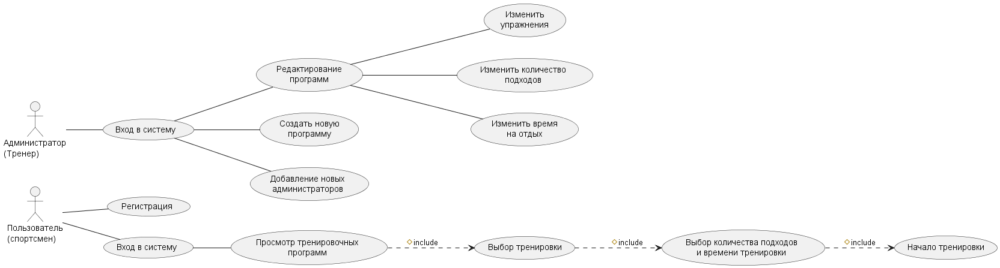
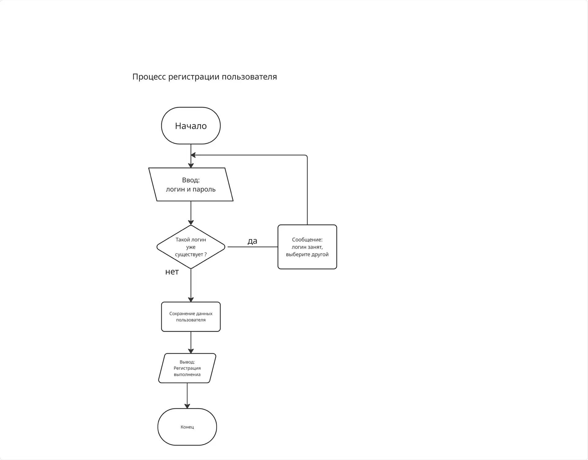
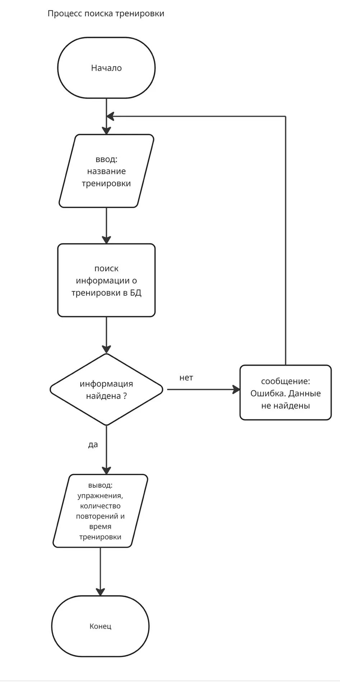
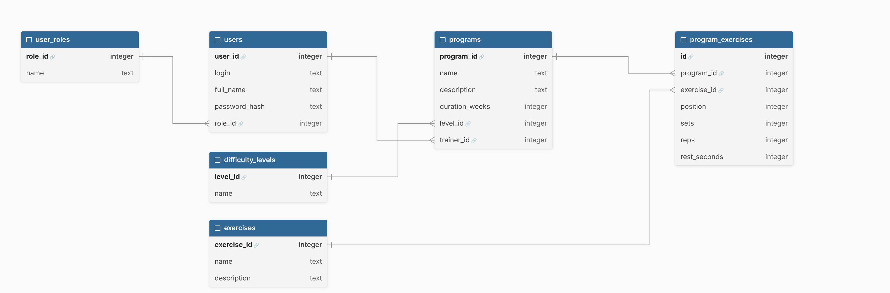

# Учёт тренировочных программ

## Описание
Система хранит тренировочные программы и упражнения.
Тренер создаёт программы, спортсмен их просматривает.

## Возможности
- создание тренировочной программы
- добавление упражнений
- просмотр списка программ

## Роли
| Роль | Что делает |
| --- | --- |
| Тренер | создаёт и изменяет программы |
| Спортсмен | просматривает и использует программы |

## Технологии
**Язык:** Python, **БД:** SQLite

## Диаграммы

### Use Case


### Блок-схема: регистрация пользователя


### Блок-схема: поиск тренировки


### ER-диаграмма


## Запуск
Нужен Python 3.10+. Из папки `src`:
```
python main.py
```
База `training.db` создаётся автоматически с тестовыми данными.
Пересоздать её заново: `python -m database.init_db`.

Тестовые аккаунты:
| Логин | Пароль | Роль |
| --- | --- | --- |
| trainer1 | trainer123 | Тренер |
| athlete1 | athlete123 | Спортсмен |
| athlete2 | athlete123 | Спортсмен |

## Архитектура (ЛР №4)
```
src/
├── main.py                 точка входа, стартовое меню
├── config.py               ID ролей
├── database/               подключение, схема, создание БД
├── models/                 dataclass-модели всех 6 таблиц
├── repositories/           CRUD, весь SQL только здесь
├── services/               бизнес-логика и проверки
└── ui/                     консольное меню, авторизация
```
Слои: **UI → сервисы → репозитории → SQLite**. UI не обращается к БД напрямую,
сервисы не содержат SQL.

## Функции по ролям
**Спортсмен:** регистрация, вход, просмотр всех программ, фильтр по уровню, поиск по названию,
подробности программы, тренировка по шагам со своими подходами и временем отдыха, смена пароля.

**Тренер:** CRUD программ (изменять и удалять может только автор), состав программы —
добавление и удаление упражнений, изменение подходов, повторов и отдыха; CRUD упражнений
(нельзя удалить используемое); список пользователей, добавление тренеров, удаление пользователей.

## Бизнес-правила
- логин: 3–20 символов латиницей, уникальный; пароль от 6 символов, хранится как SHA-256;
- самостоятельно можно зарегистрироваться только спортсменом, тренера добавляет тренер;
- длительность программы 1–52 недели; подходы 1–20, повторы 1–200, отдых 0–600 сек;
- названия упражнений уникальны (без учёта регистра), у тренера нет двух программ с одним названием;
- тренер не может удалить себя или тренера, у которого есть программы.