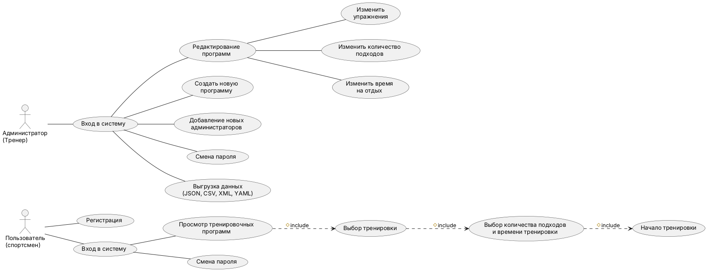
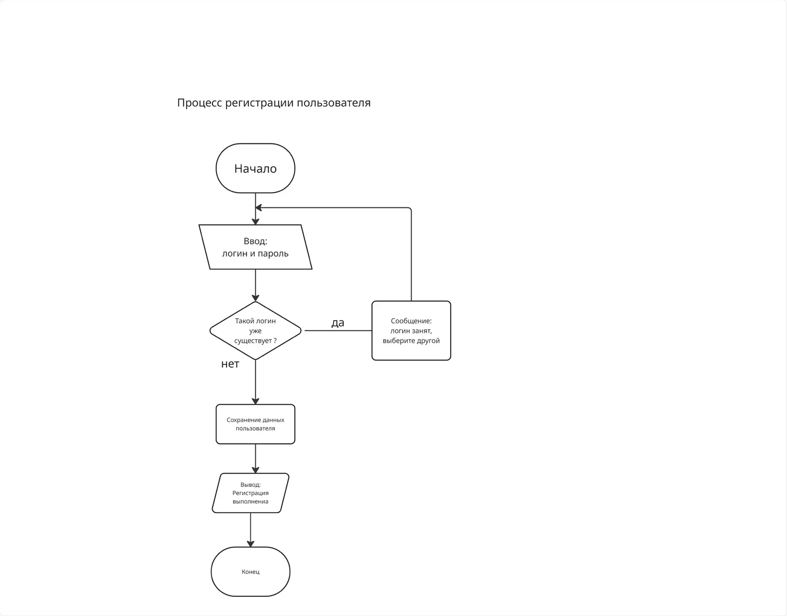
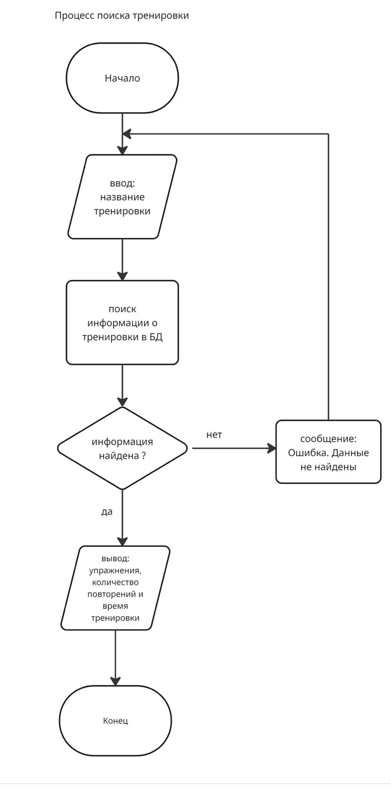
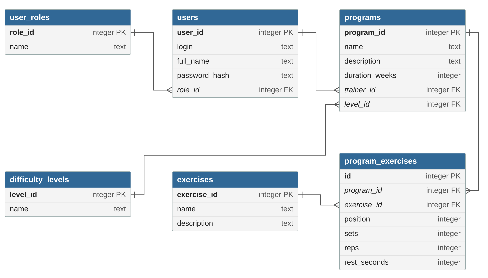

# Учёт тренировочных программ

## Описание
Система хранит тренировочные программы и упражнения.
Тренер создаёт программы, спортсмен их просматривает.

## Возможности
- создание тренировочной программы
- добавление упражнений
- просмотр списка программ

## Роли
| Роль | Что делает |
| --- | --- |
| Тренер | создаёт и изменяет программы |
| Спортсмен | просматривает и использует программы |

## Технологии
**Язык:** Python, **БД:** SQLite

## Диаграммы

### Use Case


### Блок-схема: регистрация пользователя


### Блок-схема: поиск тренировки


### ER-диаграмма


## Запуск
Нужен Python 3.10+. Из папки `src`:
```
python main.py
```
База `training.db` создаётся автоматически с тестовыми данными.
Пересоздать её заново: `python -m database.init_db`.

Тестовые аккаунты:
| Логин | Пароль | Роль |
| --- | --- | --- |
| trainer1 | trainer123 | Тренер |
| athlete1 | athlete123 | Спортсмен |
| athlete2 | athlete123 | Спортсмен |

## Архитектура (ЛР №4)
```
src/
├── main.py                 точка входа, стартовое меню
├── export.py               выгрузка данных в out/ (ЛР №5)
├── config.py               ID ролей
├── database/               подключение, схема, создание БД
├── models/                 dataclass-модели всех 6 таблиц
├── repositories/           CRUD, весь SQL только здесь
├── services/               бизнес-логика, проверки, выгрузка и сериализаторы
└── ui/                     консольное меню, авторизация
```
Слои: **UI → сервисы → репозитории → SQLite**. UI не обращается к БД напрямую,
сервисы не содержат SQL.

## Выгрузка данных (ЛР №5)
Таблица `programs` выгружается вместе со связанными данными: уровнем сложности, тренером
и списком упражнений из `program_exercises` + `exercises`. Создаются четыре файла в папке `out/`
(папка создаётся автоматически):

| Файл | Формат | Как хранятся связанные данные |
| --- | --- | --- |
| `data.json` | JSON | вложенные объекты `level`, `trainer` и массив `exercises` |
| `data.xml` | XML | вложенные теги `<level>`, `<trainer>`, `<exercises><exercise>…` |
| `data.yaml` | YAML | вложенные блоки с отступами, упражнения — список через `-` |
| `data.csv` | CSV (разделитель `;`, UTF-8 для Excel) | `level.name`, `trainer.full_name`; упражнения — в одной ячейке через `|` |

Запуск: меню тренера → **4. Выгрузка данных** или из папки `src`:
```
python export.py
```

Сериализаторы в `src/services/serializers.py` универсальны: принимают список словарей любой
структуры. Чтобы выгрузить другую таблицу, достаточно передать её записи в
`export_service.export_records(...)`, логику сериализации менять не нужно.

Пример (`out/data.json`, фрагмент):
```json
{
  "program_id": 1,
  "name": "Старт для новичков",
  "level": {"level_id": 1, "name": "Начальный"},
  "trainer": {"user_id": 1, "full_name": "Иванов Пётр"},
  "exercises": [
    {"position": 1, "exercise_id": 1, "name": "Приседания", "sets": 3, "reps": 12, "rest_seconds": 60}
  ]
}
```

## Функции по ролям
**Спортсмен:** регистрация, вход, просмотр всех программ, фильтр по уровню, поиск по названию,
подробности программы, тренировка по шагам со своими подходами и временем отдыха, смена пароля.

**Тренер:** CRUD программ (изменять и удалять может только автор), состав программы —
добавление и удаление упражнений, изменение подходов, повторов и отдыха; CRUD упражнений
(нельзя удалить используемое); список пользователей, добавление тренеров, удаление пользователей.

## Бизнес-правила
- логин: 3–20 символов латиницей, уникальный; пароль от 6 символов, хранится как SHA-256;
- самостоятельно можно зарегистрироваться только спортсменом, тренера добавляет тренер;
- длительность программы 1–52 недели; подходы 1–20, повторы 1–200, отдых 0–600 сек;
- названия упражнений уникальны (без учёта регистра), у тренера нет двух программ с одним названием;
- тренер не может удалить себя или тренера, у которого есть программы.